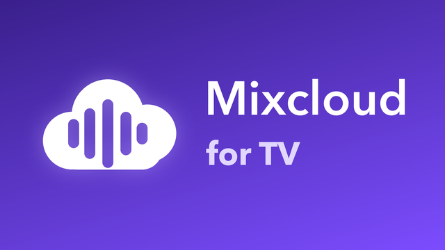

<p align="center"></p>

# Mixcloud for TV (unofficial)

An **unofficial, experimental** Mixcloud client for Android TV and Amazon Fire TV (Fire OS). Mixcloud has no app for these devices. This one lets you browse, search and listen to Mixcloud shows from the sofa with your TV remote.

It's a hobby project. It isn't published on any app store, and you build and sideload it yourself.

> ⚠️ **Read the [disclaimer](#disclaimer) before using this.** This project is not made, endorsed or supported by Mixcloud. It relies on an undocumented Mixcloud API that may break at any time, and using it may go against Mixcloud's terms of use. You use it entirely at your own risk.

## What it does

- **Browse:** popular shows by genre, search for shows and people, show pages (details, tracklist, similar shows) and user pages.
- **Listen:**
  - Native audio playback that keeps going in the background.
  - The remote's play/pause, fast-forward and rewind buttons work.
  - Scrub through a mix on the progress bar, and it remembers where you were.
- **Your account (optional):** log in by scanning a QR code with your phone. You then get new shows from people you follow, your favourites and Listen Later, and can favourite, follow/unfollow and add to Listen Later.
- **Recently played:** kept on the TV. Mixcloud only records listens made in its own players, so plays in this app don't appear in your Mixcloud listening history (and may not count as plays for the creator). Listens from your other devices are shown after the TV's own.
- **Mixcloud's limits are respected:** country/licensing blocks, play limits and Select-only shows show a message and are never bypassed. There is no download feature, and none will be added.

## How it works

| Part | Source |
|---|---|
| Browsing, search, account features | Mixcloud's public [REST API](https://www.mixcloud.com/developers/) (official) |
| Login | Mixcloud OAuth 2.0 (official). The TV runs a short-lived web server on your local network to receive the login from your phone. |
| Audio stream URLs | Mixcloud's **undocumented** GraphQL API, the one the mixcloud.com website uses. This part is unofficial and is isolated in [`GraphqlStreamResolver.kt`](app/src/main/java/dev/mixcloudtv/data/stream/GraphqlStreamResolver.kt). |

Built with Kotlin, Jetpack Compose for TV, Media3/ExoPlayer and OkHttp.

## Requirements

- An **Android TV / Google TV** device, or a **Fire TV running Fire OS** (for example Fire TV Stick 4K, 4K Max, Cube, Lite).
  - **Vega OS** Fire TV devices (Fire TV Stick 4K Select, 2026 Fire TV Stick HD) **cannot** install Android apps.
- A computer with JDK 17 and the Android SDK (platform 37.2) to build it.
- Optional, for login: your own Mixcloud API application.

## Build

```sh
export JAVA_HOME=/path/to/jdk-17
./gradlew :app:assembleRelease
# -> app/build/outputs/apk/release/app-release.apk
```

Unless `local.properties` names your own keystore, release builds are signed with your local debug key:

```properties
RELEASE_STORE_FILE=/path/to/your.jks
RELEASE_STORE_PASSWORD=...
RELEASE_KEY_ALIAS=...
RELEASE_KEY_PASSWORD=...
```

Run the unit tests with `./gradlew :app:testDebugUnitTest`. Contributors (human or AI) should read [AGENTS.md](AGENTS.md) first. It sets out the project's hard rules, such as no downloading and no bypassing Mixcloud's restrictions.

## Install (sideload)

1. On the TV, turn on **Developer options**. On Fire TV: Settings → My Fire TV → About, then press OK on the device name 7 times.
2. In Developer options, turn on **ADB debugging** and **Install unknown apps** / **Apps from unknown sources**.
3. From your computer:
   ```sh
   adb connect <tv-ip-address>:5555   # accept the prompt on the TV
   adb install -r app/build/outputs/apk/release/app-release.apk
   ```
4. When you've finished installing, consider **turning ADB debugging off again**. While it's on, anything on your network that you have authorised can control the TV.

## Logging in (optional)

1. Create your own application at <https://www.mixcloud.com/developers/>.
2. Put its credentials in `local.properties` (this file is git-ignored; never commit it):
   ```properties
   MIXCLOUD_CLIENT_ID=...
   MIXCLOUD_CLIENT_SECRET=...
   ```
3. Rebuild and reinstall. Choose **Log in** in the app and scan the QR code with a phone on the **same Wi-Fi network**.
4. If your phone can't reach the TV within 30 seconds, the screen switches to a code login by itself (or choose **Phone can't connect? Use a code**). Some phones, browsers, VPNs and networks block traffic to devices on your network. The second QR code opens Mixcloud directly, and Mixcloud shows a code for you to enter on the TV. The code is long, so paste it with the Fire TV phone app's keyboard. You only need to log in once.

> 🔐 Your client secret is compiled into the APK you build. **Don't share that APK with anyone.** Anyone who has it can extract your secret. Each person should build the app with their own Mixcloud application.

## Security notes

- **Login server:** while the login screen is open, the app listens on port 8765 on your local network.
  - It only responds to the random one-time link in the QR code.
  - It accepts a single login, then shuts down when you leave the screen.
  - Only log in on a network you trust.
- **Known login limitations:** these come from how Mixcloud's OAuth works.
  - Mixcloud requires a client secret and doesn't support PKCE, so the secret has to be built into the app.
  - The login callback from your phone to the TV travels over plain HTTP on your local network. Anyone who can intercept traffic on that network while you log in could capture the one-time login code. If that matters to you, don't use the login feature.
  - The code is exchanged for a token in a single HTTPS request sent directly to Mixcloud. The app never logs it.
- **Token storage:** your Mixcloud access token is stored in the app's private storage on the TV and sent only to Mixcloud over HTTPS, in a request header. Android backups are turned off for the app, so the token isn't copied off the device. Logging out deletes it.
- **What's stored on the TV:** everything below is kept in the app's private storage and never uploaded anywhere.
  - Your login token (see above).
  - A list of the last 30 shows you played: show details only, such as title, DJ and artwork links.
  - How far into each show you got, for resuming.

  No audio is ever saved: shows are always streamed. Clearing the app's data (Settings → Applications → Mixcloud for TV → Clear data) or uninstalling removes all of it.
- **Debug builds only:** these accept `adb shell am start -d "mixcloudtv://token?access_token=…"` to set a token. Release builds don't.
- **Reporting issues:** if you find a security problem, please open an issue without exploit details, or contact the maintainer privately.

## Disclaimer

**Please read this carefully. By building, installing or using this software you agree to all of the following.**

- **Not affiliated with Mixcloud.** This is an independent, unofficial project. It is not made, endorsed, sponsored or supported by Mixcloud Ltd. "Mixcloud" is a trademark of its owner and is used here only to describe what the software works with. Don't contact Mixcloud for help with this app.
- **Experimental and for personal, educational use only.** This software is a technical experiment. It isn't a finished product and isn't intended for commercial use, redistribution as a service, or use at scale.
- **No warranty.** The software is provided **"as is", without warranty of any kind**, express or implied. This includes, without limitation, warranties of merchantability, fitness for a particular purpose, and non-infringement. It may contain bugs, stop working at any time, or behave unexpectedly. See [LICENSE](LICENSE).
- **No liability.** To the fullest extent permitted by law, the authors and contributors are **not liable for any loss or damage of any kind** arising from using or being unable to use this software. That includes, without limitation:
  - suspension, restriction or **banning of your Mixcloud account** (or any other account);
  - damage to, malfunction of, or data loss on **your TV, streaming device, phone, computer or network**;
  - **security incidents**, including unauthorised access to your device, network or accounts;
  - voided warranties, or breaches of any agreement with your device maker, service provider or Mixcloud;
  - any other direct, indirect, incidental, special or consequential loss.
- **You are responsible for how you use it.** You are solely responsible for:
  - complying with Mixcloud's [Terms of Use](https://www.mixcloud.com/terms/), its API terms, and all laws that apply to you;
  - the security of your own devices, networks, accounts and API credentials.

  The authors don't condone using this software to infringe copyright, get around content restrictions, download or redistribute content, or break any service's terms, and accept no responsibility if you do.
- **Respect artists.** Mixcloud licenses the music it streams and pays creators. Please support the creators you listen to. Use the official Mixcloud apps and website where you can, and consider a Mixcloud subscription.
- **Unofficial API.** Parts of this software use undocumented interfaces that Mixcloud has not authorised for third-party use. Mixcloud may change or block them, or take action against their use, at any time.
- **Sideloading risks.** Enabling developer options, ADB debugging and installing apps from unknown sources lowers your device's security. Only do this if you understand the risks, and only install APKs you built yourself from source you have reviewed.
- **Takedown.** If you represent Mixcloud or a rights holder and have concerns about this project, please open an issue. We'll respond promptly, including by removing the project if appropriate.

## License

[MIT](LICENSE). Provided as is, without warranty.
